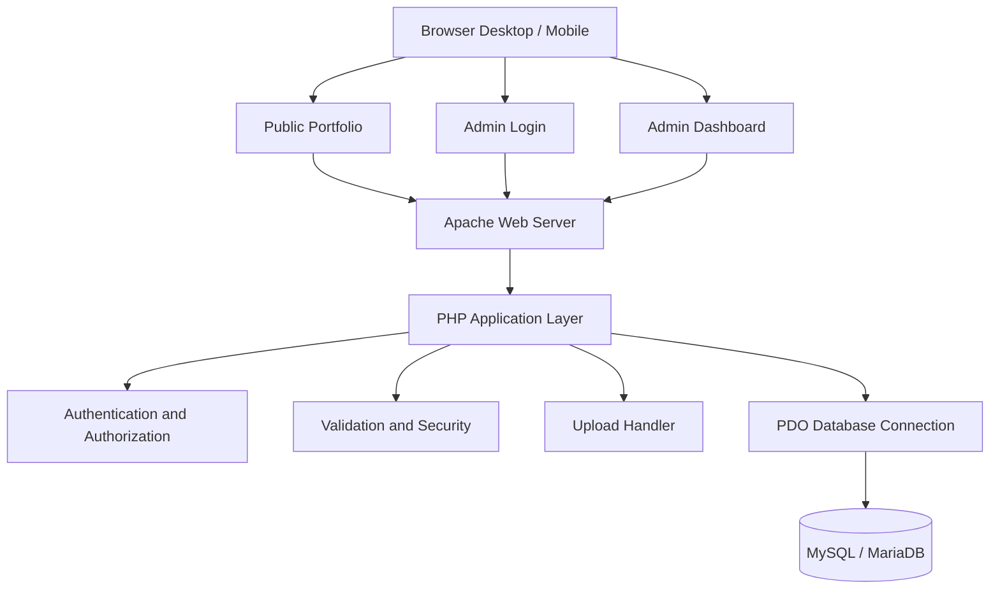
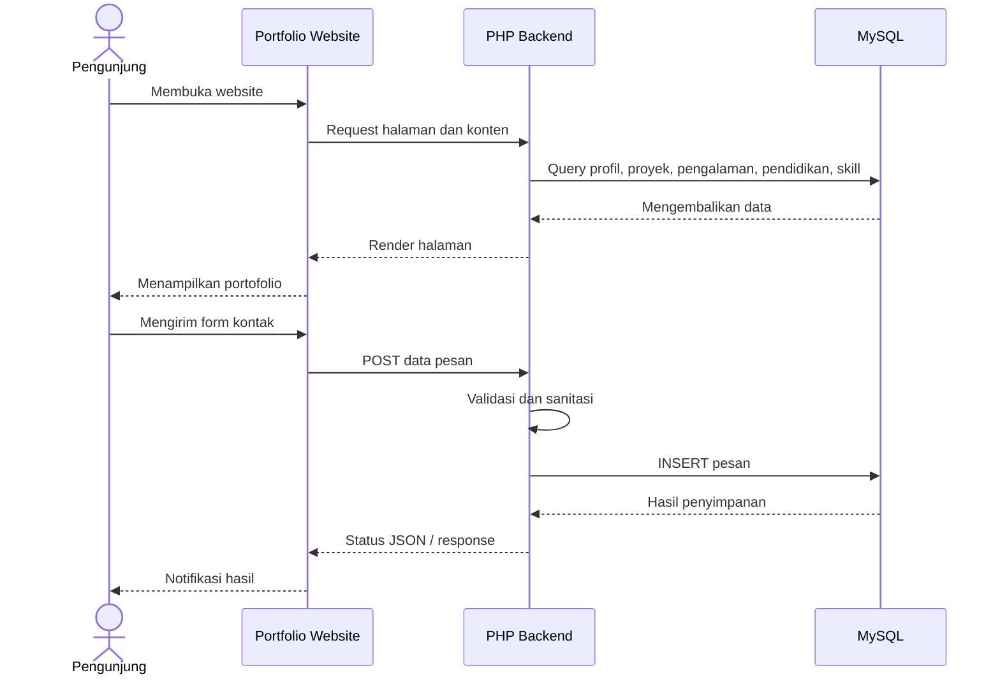
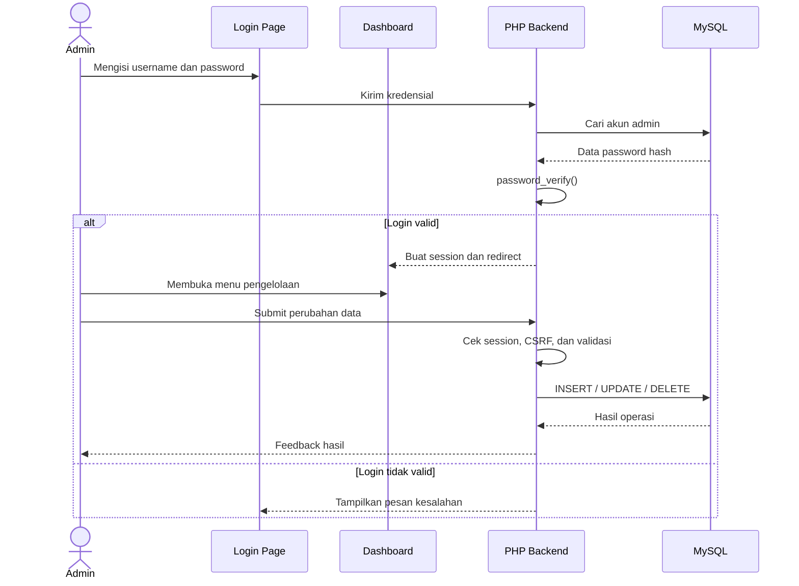

# DESAIN SISTEM & UI/UX (DESIGN DOCUMENT)

## MyFolio --- Personal Portfolio CMS untuk Mahasiswa Bisnis Digital

  -----------------------------------------------------------------------
  Informasi Dokumen                   Keterangan
  ----------------------------------- -----------------------------------
  Nama Proyek                         MyFolio --- Personal Portfolio CMS

  Tipe Dokumen                        Software Design Document (SDD) &
                                      UI/UX Design System

  Versi Dokumen                       2.0

  Status                              Rancangan / Draft Pengembangan

  Pengguna Utama                      Mahasiswa Bisnis Digital

  Backend                             PHP 8.2 Native

  Database                            MySQL / MariaDB

  Database Access                     PDO

  Frontend                            HTML5, CSS3, Bootstrap 5.3, Vanilla
                                      JavaScript

  Development Environment             XAMPP

  Bahasa Antarmuka                    Bahasa Indonesia dengan istilah
                                      profesional berbahasa Inggris
                                      seperlunya
  -----------------------------------------------------------------------

> Dokumen ini merupakan rancangan baru MyFolio. Dokumen ini menggantikan
> konsep desain sebelumnya yang menggunakan tema dark-mode
> glassmorphism. Fokus versi ini adalah personal branding mahasiswa
> Bisnis Digital dengan tampilan Modern Creative, palet olive green dan
> light grey, serta CMS Admin Dashboard.

------------------------------------------------------------------------

# 1. Gambaran Umum Proyek

## 1.1 Latar Belakang

MyFolio merupakan website portofolio pribadi yang digunakan untuk
memperkenalkan profil, menampilkan proyek, mendokumentasikan pengalaman,
menyajikan riwayat pendidikan, dan menunjukkan keterampilan pemilik
portofolio. Website dilengkapi Admin Dashboard agar konten dapat
dikelola tanpa mengubah kode program secara langsung.

Website ditujukan untuk mendukung personal branding mahasiswa Bisnis
Digital, terutama ketika memperkenalkan diri kepada recruiter,
perusahaan, dosen, calon kolaborator, maupun calon partner proyek.

## 1.2 Tujuan Sistem

1.  Menampilkan deskripsi diri dan identitas profesional.
2.  Menampilkan proyek yang pernah dikerjakan beserta dokumentasinya.
3.  Menampilkan pengalaman kerja, organisasi, kepanitiaan, dan kegiatan
    relevan.
4.  Menampilkan riwayat pendidikan.
5.  Mengelompokkan dan menampilkan keterampilan.
6.  Menyediakan CTA (Call to Action) dan formulir kontak.
7.  Memungkinkan administrator mengelola seluruh konten melalui
    dashboard.

## 1.3 Ruang Lingkup

### Halaman publik

-   Hero / Introduction.
-   About Me.
-   Projects.
-   Experience.
-   Education.
-   Skills.
-   Contact / CTA.
-   Footer dan tautan media sosial.

### Panel administrator

-   Login dan logout.
-   Dashboard Overview.
-   Pengelolaan profil.
-   Pengelolaan proyek.
-   Pengelolaan pengalaman.
-   Pengelolaan pendidikan.
-   Pengelolaan skill.
-   Inbox pesan.
-   Pengelolaan tautan media sosial.
-   Pengaturan akun dan keamanan.

## 1.4 Target Pengunjung

-   Recruiter dan HRD.
-   Perusahaan yang membuka kesempatan magang atau pekerjaan.
-   Dosen dan lingkungan akademik.
-   Calon partner bisnis dan kolaborator.
-   Klien atau pihak yang tertarik dengan proyek pemilik portofolio.

------------------------------------------------------------------------

# 2. Filosofi dan Prinsip Desain UI/UX

MyFolio menggunakan gaya **Modern Creative**, yaitu tampilan modern,
bersih, ekspresif, dan profesional. Desain memadukan layout modular,
komposisi asimetris yang terkontrol, tipografi tegas, serta ruang kosong
yang cukup agar konten mudah dibaca.

## 2.1 Prinsip Utama

1.  **Modern & Professional** --- tampilan profesional yang tetap
    memiliki karakter kreatif.
2.  **Content First** --- pengalaman, proyek, dan kemampuan pemilik
    menjadi fokus utama.
3.  **Clear Navigation** --- navigasi sederhana dan mudah dipahami.
4.  **Consistent Visual Identity** --- penggunaan warna, tipografi,
    tombol, dan komponen yang konsisten.
5.  **Responsive Design** --- layout menyesuaikan desktop, tablet, dan
    smartphone.
6.  **Accessible & Readable** --- ukuran teks, kontras, label, dan
    interaksi dibuat mudah digunakan.
7.  **Easy Content Management** --- konten publik dikelola melalui Admin
    Dashboard.

## 2.2 Gaya Visual

-   Background utama light grey.
-   Aksen olive green untuk tombol utama, tautan aktif, ikon, dan
    highlight.
-   Teks utama dark charcoal.
-   Card berwarna putih atau light grey dengan border tipis.
-   Sudut komponen sedikit membulat.
-   Penggunaan foto profil dan thumbnail proyek sebagai elemen visual.
-   Animasi ringan, tidak mengganggu keterbacaan.
-   Layout asimetris digunakan secara terkontrol pada hero dan area
    proyek.

------------------------------------------------------------------------

# 3. Sistem Desain dan Token Visual

## 3.1 Palet Warna

  -----------------------------------------------------------------------
  Nama Warna              HEX                     Penggunaan
  ----------------------- ----------------------- -----------------------
  Primary Olive           `#5C6F2B`               Tombol utama, aksen,
                                                  link aktif, highlight

  Light Grey              `#EEEEEE`               Background utama

  Dark Charcoal           `#25291F`               Heading dan teks utama

  Soft Olive              `#DCE3CB`               Badge, latar highlight,
                                                  elemen dekoratif

  White                   `#FFFFFF`               Card, modal, area
                                                  konten

  Muted Text              `#686D60`               Paragraf sekunder dan
                                                  metadata

  Border                  `#D8DAD2`               Garis pembatas dan
                                                  border card

  Success                 `#287A4B`               Status berhasil

  Warning                 `#A66A12`               Peringatan

  Danger                  `#B83B36`               Hapus data dan pesan
                                                  error
  -----------------------------------------------------------------------

## 3.2 CSS Design Tokens

``` css
:root {
    --color-primary: #5C6F2B;
    --color-background: #EEEEEE;
    --color-dark: #25291F;
    --color-soft-olive: #DCE3CB;
    --color-white: #FFFFFF;
    --color-muted: #686D60;
    --color-border: #D8DAD2;

    --font-heading: 'Plus Jakarta Sans', sans-serif;
    --font-body: 'Inter', sans-serif;

    --radius-card: 16px;
    --radius-button: 10px;
    --shadow-card: 0 8px 24px rgba(37, 41, 31, 0.06);
}
```

## 3.3 Tipografi

  Elemen                Rekomendasi
  --------------------- -----------------------------------------------
  Font Heading          Plus Jakarta Sans
  Font Body             Inter
  Hero Title            48--64 px desktop, responsif pada layar kecil
  Section Title         32--40 px
  Card Title            18--22 px
  Body Text             15--16 px
  Caption / Metadata    12--14 px
  Font Weight Heading   700--800
  Font Weight Body      400--500

Ukuran akhir harus disesuaikan dengan breakpoint dan keterbacaan
perangkat.

## 3.4 Komponen Visual

-   Primary Button: background olive green, teks putih.
-   Secondary Button: background transparan atau putih, border olive.
-   Project Card: thumbnail, kategori, judul, deskripsi singkat, dan
    tautan detail.
-   Skill Badge: label kategori atau nama skill.
-   Timeline Item: penanda waktu, posisi, organisasi/institusi, dan
    deskripsi.
-   Form Input: label jelas, border halus, focus state yang terlihat.
-   Admin Sidebar: navigasi vertikal dengan penanda menu aktif.

------------------------------------------------------------------------

# 4. Struktur Halaman Publik

Website publik menggunakan pendekatan **One Page Portfolio**. Navbar
mengarahkan pengunjung ke section yang sesuai. Detail proyek dapat
dibuka melalui halaman detail atau modal.

## 4.1 Navbar

Elemen: - Logo / nama personal. - Home. - About. - Projects. -
Experience. - Education. - Skills. - Contact. - Tombol CTA atau Download
CV (jika file CV tersedia).

Pada layar smartphone, navigasi berubah menjadi menu hamburger.

## 4.2 Hero / Introduction

Tujuan: memberikan kesan pertama dan memperkenalkan pemilik portofolio.

Konten: - Sapaan singkat. - Nama lengkap. - Headline sebagai mahasiswa
Bisnis Digital. - Deskripsi ringkas. - Foto profil. - Tombol Explore My
Work. - Tombol Contact Me. - Tautan sosial profesional jika tersedia.

Contoh headline: \> Turning Ideas Into Meaningful Digital Experiences.

Contoh deskripsi: \> Mahasiswa Bisnis Digital yang tertarik pada
pengembangan bisnis, kreativitas, dan pemanfaatan teknologi digital
untuk menciptakan solusi yang bermanfaat.

Teks contoh harus disesuaikan dengan profil dan preferensi pemilik
sebelum dipublikasikan.

## 4.3 About Me

Konten: - Deskripsi diri. - Latar belakang pendidikan. - Minat
profesional. - Bidang yang sedang dipelajari. - Nilai atau pendekatan
kerja.

Penyajian: - Paragraf ringkas. - Foto atau elemen visual pendukung
opsional. - Badge bidang minat. - CTA menuju proyek atau kontak.

## 4.4 Projects

Tujuan: menampilkan hasil karya dan kontribusi pemilik.

Kategori awal yang disarankan: - Business Planning. - Digital
Marketing. - Website & Application. - UI/UX Design. - Research &
Community Projects. - Other Projects.

Setiap kartu proyek menampilkan: - Thumbnail. - Judul proyek. -
Kategori. - Deskripsi singkat. - Tahun atau periode jika tersedia. -
Tombol View Details.

Detail proyek dapat berisi: - Latar belakang atau masalah. - Tujuan
proyek. - Peran dan tanggung jawab pemilik. - Proses pengerjaan. - Tools
atau teknologi yang digunakan. - Hasil atau dampak. - Dokumentasi. -
Link demo, publikasi, atau repository jika tersedia.

Fitur: - Filter berdasarkan kategori tanpa reload halaman. - Penanda
Featured Project. - Status Draft / Published. - Urutan proyek terbaru
atau pilihan admin.

## 4.5 Experience

Tujuan: menunjukkan pengalaman profesional dan non-akademik yang
relevan.

Kategori pengalaman: - Work Experience. - Organization Experience. -
Committee Experience. - Competition & Events. - Volunteer / Community
Activities.

Setiap item berisi: - Posisi atau peran. - Nama
organisasi/perusahaan/kegiatan. - Periode. - Deskripsi tanggung jawab. -
Pencapaian atau kontribusi jika tersedia.

Penyajian menggunakan timeline vertikal atau card berdasarkan periode.

## 4.6 Education

Tujuan: menampilkan perjalanan pendidikan.

Setiap item berisi: - Nama institusi. - Jenjang atau gelar. - Program
studi / jurusan. - Periode. - Deskripsi opsional. - Logo atau foto
institusi opsional.

Data pendidikan ditampilkan berdasarkan urutan periode, dengan
pendidikan terbaru di posisi teratas.

## 4.7 Skills

Tujuan: menunjukkan kemampuan yang relevan dengan bidang Bisnis Digital.

Kategori awal: - Digital Tools. - Business & Entrepreneurship. -
Administration & Data. - Communication. - Personal / Soft Skills.

Setiap skill dapat memiliki: - Nama skill. - Kategori. - Deskripsi
opsional. - Level atau indikator kemampuan opsional.

Catatan: jangan menampilkan persentase penguasaan yang tidak memiliki
dasar penilaian. Jika level digunakan, pilih label yang dapat
dipertanggungjawabkan seperti Beginner, Intermediate, atau Advanced.

## 4.8 Contact / CTA

Tujuan: mengarahkan pengunjung untuk menghubungi pemilik portofolio.

Contoh headline: \> Have an Idea? Let's Make It Happen.

Elemen: - Kalimat ajakan berkolaborasi. - Email. - WhatsApp jika
disediakan. - LinkedIn dan media sosial profesional. - Form kontak.

Field form: - Nama. - Email. - Subjek (opsional). - Pesan.

Perilaku: - Validasi input di sisi browser dan server. - Pesan disimpan
ke tabel `messages`. - Tampilkan notifikasi berhasil atau gagal. -
Lindungi form dari spam dan request berbahaya.

## 4.9 Footer

Elemen: - Nama pemilik. - Copyright dan tahun dinamis. - Tautan
navigasi. - Tautan sosial. - Tombol kembali ke atas.

------------------------------------------------------------------------

# 5. Admin Dashboard / Content Management System

## 5.1 Tujuan

Admin Dashboard digunakan untuk mengelola seluruh konten website melalui
antarmuka khusus administrator.

Akses dashboard harus memerlukan autentikasi. Pengunjung publik tidak
dapat mengakses halaman pengelolaan.

## 5.2 Struktur Navigasi Admin

1.  Dashboard Overview.
2.  Manage Profile.
3.  Manage Projects.
4.  Manage Experience.
5.  Manage Education.
6.  Manage Skills.
7.  Messages / Inbox.
8.  Social Links.
9.  Settings.
10. Logout.

## 5.3 Dashboard Overview

Menampilkan ringkasan: - Total proyek yang dipublikasikan. - Total
pengalaman. - Total pendidikan. - Total skill. - Jumlah pesan masuk. -
Jumlah pesan belum dibaca. - Aktivitas atau konten terbaru.

Statistik harus dihitung dari data database, bukan angka statis.

## 5.4 Manage Profile

Fungsi: - Edit nama lengkap. - Edit headline. - Edit deskripsi diri. -
Upload / ganti foto profil. - Mengatur email dan nomor kontak. -
Mengatur lokasi jika ingin ditampilkan. - Upload / ganti CV. - Mengatur
status ketersediaan jika fitur digunakan.

## 5.5 Manage Projects

Fungsi: - Tambah proyek. - Edit proyek. - Hapus proyek dengan
konfirmasi. - Upload thumbnail. - Mengisi deskripsi dan detail proyek. -
Memilih kategori. - Mengatur Featured. - Mengatur Draft / Published. -
Mengatur tautan demo atau repository.

## 5.6 Manage Experience

Fungsi: - Tambah pengalaman. - Edit pengalaman. - Hapus pengalaman. -
Mengatur kategori pengalaman. - Mengatur posisi, organisasi, periode,
deskripsi, dan urutan tampil.

## 5.7 Manage Education

Fungsi: - Tambah pendidikan. - Edit pendidikan. - Hapus pendidikan. -
Mengatur institusi, jenjang, jurusan, periode, dan deskripsi.

## 5.8 Manage Skills

Fungsi: - Tambah skill. - Edit skill. - Hapus skill. - Mengatur
kategori. - Mengatur urutan tampil. - Mengatur level kemampuan jika
digunakan.

## 5.9 Messages / Inbox

Fungsi: - Melihat daftar pesan masuk. - Membuka detail pesan. - Menandai
pesan sudah / belum dibaca. - Menghapus pesan dengan konfirmasi. -
Menampilkan nama, email, subjek, isi pesan, dan tanggal.

## 5.10 Social Links

Fungsi: - Menambah tautan sosial. - Mengubah platform dan URL. -
Menghapus tautan. - Mengatur urutan tampil. - Mengaktifkan atau
menonaktifkan tautan.

## 5.11 Settings

Fungsi: - Mengubah username jika diizinkan. - Mengubah password. -
Mengatur informasi dasar website. - Mengatur preferensi tampilan
tertentu jika diperlukan.

## 5.12 Standar Interaksi Admin

-   Setiap aksi CRUD memberikan feedback.
-   Penghapusan memerlukan konfirmasi.
-   Form memiliki validasi.
-   Tabel memiliki empty state ketika belum ada data.
-   Status Draft dan Published terlihat jelas.
-   Navigasi aktif ditandai.
-   Tampilan admin responsif.
-   Session berakhir melalui logout yang aman.

------------------------------------------------------------------------

# 6. Perancangan Database

Nama database: `db_myfolio`.

Database menggunakan MySQL atau MariaDB dengan akses melalui PDO.

## 6.1 Daftar Tabel

  Tabel            Fungsi
  ---------------- --------------------------------------------
  `admins`         Akun administrator
  `profile`        Informasi profil pemilik
  `projects`       Data dan detail proyek
  `experiences`    Pengalaman kerja, organisasi, dan kegiatan
  `education`      Riwayat pendidikan
  `skills`         Daftar keahlian
  `messages`       Pesan yang dikirim pengunjung
  `social_links`   Tautan media sosial

## 6.2 Spesifikasi Tabel

### A. `admins`

  Kolom           Tipe           Keterangan
  --------------- -------------- ------------------
  id              INT, PK, AI    ID admin
  username        VARCHAR(50)    Username unik
  password_hash   VARCHAR(255)   Hash password
  created_at      TIMESTAMP      Waktu dibuat
  updated_at      TIMESTAMP      Waktu diperbarui

Password tidak boleh disimpan dalam bentuk teks biasa.

### B. `profile`

  Kolom        Tipe                 Keterangan
  ------------ -------------------- ------------------------
  id           INT, PK, AI          ID profil
  full_name    VARCHAR(100)         Nama lengkap
  headline     VARCHAR(180)         Headline profesional
  about_me     TEXT                 Deskripsi diri
  email        VARCHAR(120)         Email publik
  phone        VARCHAR(30), NULL    Nomor kontak
  location     VARCHAR(120), NULL   Lokasi publik opsional
  avatar       VARCHAR(255), NULL   Path foto profil
  cv_path      VARCHAR(255), NULL   Path file CV
  updated_at   TIMESTAMP            Waktu pembaruan

Untuk versi awal, profil dapat menggunakan satu record utama.

### C. `projects`

  Kolom               Tipe                   Keterangan
  ------------------- ---------------------- -----------------------
  id                  INT, PK, AI            ID proyek
  title               VARCHAR(150)           Judul proyek
  slug                VARCHAR(180), UNIQUE   Identitas URL
  category            VARCHAR(80)            Kategori proyek
  short_description   VARCHAR(255)           Ringkasan proyek
  description         TEXT                   Deskripsi lengkap
  role                VARCHAR(120), NULL     Peran pemilik
  process             TEXT, NULL             Proses pengerjaan
  result              TEXT, NULL             Hasil atau dampak
  tools               TEXT, NULL             Tools yang digunakan
  thumbnail           VARCHAR(255), NULL     Path thumbnail
  project_url         VARCHAR(255), NULL     Link demo / publikasi
  repository_url      VARCHAR(255), NULL     Link repository
  is_featured         TINYINT(1)             Proyek unggulan
  status              ENUM                   `draft`, `published`
  sort_order          INT                    Urutan tampil
  created_at          TIMESTAMP              Waktu dibuat
  updated_at          TIMESTAMP              Waktu diperbarui

### D. `experiences`

  -----------------------------------------------------------------------
  Kolom                   Tipe                    Keterangan
  ----------------------- ----------------------- -----------------------
  id                      INT, PK, AI             ID pengalaman

  type                    VARCHAR(50)             Work, Organization,
                                                  Committee, Competition,
                                                  Volunteer

  title                   VARCHAR(150)            Posisi atau peran

  organization            VARCHAR(150)            Nama institusi /
                                                  organisasi

  period_start            DATE, NULL              Tanggal mulai

  period_end              DATE, NULL              Tanggal selesai

  is_current              TINYINT(1)              Masih berlangsung

  description             TEXT                    Deskripsi pengalaman

  achievements            TEXT, NULL              Kontribusi / pencapaian

  sort_order              INT                     Urutan tampil

  created_at              TIMESTAMP               Waktu dibuat

  updated_at              TIMESTAMP               Waktu diperbarui
  -----------------------------------------------------------------------

### E. `education`

  Kolom          Tipe           Keterangan
  -------------- -------------- -------------------------
  id             INT, PK, AI    ID pendidikan
  institution    VARCHAR(150)   Nama institusi
  degree         VARCHAR(100)   Jenjang pendidikan
  major          VARCHAR(120)   Jurusan / program studi
  period_start   DATE, NULL     Tanggal mulai
  period_end     DATE, NULL     Tanggal selesai
  is_current     TINYINT(1)     Masih berlangsung
  description    TEXT, NULL     Deskripsi tambahan
  sort_order     INT            Urutan tampil
  created_at     TIMESTAMP      Waktu dibuat
  updated_at     TIMESTAMP      Waktu diperbarui

### F. `skills`

  Kolom         Tipe                 Keterangan
  ------------- -------------------- --------------------------
  id            INT, PK, AI          ID skill
  skill_name    VARCHAR(100)         Nama keahlian
  category      VARCHAR(80)          Kategori skill
  proficiency   VARCHAR(30), NULL    Level kemampuan opsional
  description   VARCHAR(255), NULL   Keterangan
  sort_order    INT                  Urutan tampil
  created_at    TIMESTAMP            Waktu dibuat
  updated_at    TIMESTAMP            Waktu diperbarui

### G. `messages`

  Kolom          Tipe                 Keterangan
  -------------- -------------------- ----------------
  id             INT, PK, AI          ID pesan
  sender_name    VARCHAR(100)         Nama pengirim
  sender_email   VARCHAR(120)         Email pengirim
  subject        VARCHAR(150), NULL   Subjek pesan
  message        TEXT                 Isi pesan
  is_read        TINYINT(1)           Status baca
  sent_at        TIMESTAMP            Waktu masuk

### H. `social_links`

  Kolom        Tipe           Keterangan
  ------------ -------------- ------------------
  id           INT, PK, AI    ID tautan
  platform     VARCHAR(50)    Nama platform
  url          VARCHAR(255)   URL profil
  is_active    TINYINT(1)     Status tampil
  sort_order   INT            Urutan tampil
  created_at   TIMESTAMP      Waktu dibuat
  updated_at   TIMESTAMP      Waktu diperbarui

## 6.3 Relasi dan Pengambilan Data

Tabel konten utama dikelola secara independen. Pada rancangan awal,
`profile` merupakan profil utama, sedangkan `projects`, `experiences`,
`education`, `skills`, dan `social_links` merupakan kumpulan data yang
ditampilkan pada halaman publik.

Tabel `messages` menyimpan pesan dari pengunjung. Tabel `admins`
digunakan untuk autentikasi dashboard.

Tidak diperlukan relasi foreign key antara tabel-tabel konten tersebut
pada versi awal, kecuali kebutuhan pengembangan berikutnya
mengharuskannya.

------------------------------------------------------------------------

# 7. Arsitektur Sistem

## 7.1 Pola Arsitektur

Aplikasi menggunakan pola **Modular PHP Native** dengan pemisahan
konfigurasi, helper, autentikasi, halaman publik, dan halaman admin.

Komponen: - Browser: menampilkan halaman publik dan dashboard. - Web
Server: Apache melalui XAMPP. - Backend: PHP 8.2 Native. - Database:
MySQL / MariaDB. - Database Layer: PDO. - Frontend: Bootstrap 5.3, CSS,
dan Vanilla JavaScript. - Upload Storage: direktori `uploads/`.

## 7.2 Diagram Arsitektur



## 7.3 Diagram Alur Pengunjung



## 7.4 Diagram Alur Admin



------------------------------------------------------------------------

# 8. Struktur Direktori Proyek

Direktori pengembangan lokal:

`C:\xampp\htdocs\MyPortfolio\`

``` text
MyPortfolio/
│
├── admin/
│   ├── index.php
│   ├── login.php
│   ├── logout.php
│   ├── dashboard.php
│   ├── profile.php
│   ├── projects.php
│   ├── experiences.php
│   ├── education.php
│   ├── skills.php
│   ├── messages.php
│   ├── social-links.php
│   └── settings.php
│
├── config/
│   └── database.php
│
├── includes/
│   ├── functions.php
│   ├── auth.php
│   ├── csrf.php
│   ├── header.php
│   ├── navbar.php
│   └── footer.php
│
├── assets/
│   ├── css/
│   │   ├── style.css
│   │   └── admin.css
│   ├── js/
│   │   ├── main.js
│   │   └── admin.js
│   └── img/
│       └── placeholder.png
│
├── uploads/
│   ├── profile/
│   ├── projects/
│   └── cv/
│
├── database.sql
├── index.php
└── .htaccess
```

Keterangan: - `index.php`: halaman utama publik. - `admin/`: seluruh
halaman CMS. - `config/database.php`: koneksi PDO. - `includes/`:
helper, autentikasi, CSRF, dan layout bersama. - `assets/`: CSS,
JavaScript, dan aset statis. - `uploads/`: file yang diunggah
administrator. - `database.sql`: skema database dan data awal bila
diperlukan.

File dan folder dapat disesuaikan selama pemisahan tanggung jawab tetap
jelas.

------------------------------------------------------------------------

# 9. Standar Keamanan dan Reliabilitas

## 9.1 SQL Injection

Semua query dengan input pengguna harus menggunakan PDO Prepared
Statements.

Contoh:

``` php
$stmt = $pdo->prepare(
    "SELECT * FROM admins WHERE username = :username LIMIT 1"
);
$stmt->execute(['username' => $username]);
$admin = $stmt->fetch(PDO::FETCH_ASSOC);
```

## 9.2 Password Hashing

Gunakan `password_hash()` untuk menyimpan password dan
`password_verify()` untuk memeriksa password.

``` php
$hash = password_hash($password, PASSWORD_DEFAULT);

if (password_verify($inputPassword, $admin['password_hash'])) {
    // Autentikasi berhasil
}
```

Password tidak boleh disimpan atau ditampilkan sebagai teks biasa.

## 9.3 Cross-Site Scripting (XSS)

Escape seluruh data dinamis sebelum ditampilkan ke HTML.

``` php
function e(?string $value): string {
    return htmlspecialchars(
        $value ?? '',
        ENT_QUOTES,
        'UTF-8'
    );
}
```

## 9.4 Cross-Site Request Forgery (CSRF)

-   Buat token menggunakan sumber acak kriptografis.
-   Sertakan token pada form yang mengubah data.
-   Validasi token di server untuk setiap request yang relevan.
-   Tolak request jika token tidak valid.

## 9.5 Session Security

-   Gunakan session untuk autentikasi admin.
-   Regenerasi session ID setelah login berhasil.
-   Terapkan cookie `HttpOnly`, `Secure` pada HTTPS, dan `SameSite`.
-   Lindungi seluruh halaman admin.
-   Hapus session ketika logout.

## 9.6 File Upload Security

-   Batasi ekstensi dan MIME type yang diperbolehkan.
-   Batasi ukuran file.
-   Gunakan nama file acak.
-   Jangan mempercayai nama file dari pengguna.
-   Simpan file pada direktori upload yang dibatasi.
-   Cegah file upload dieksekusi sebagai script.
-   Validasi gambar dan dokumen sesuai jenis file.

## 9.7 Form Kontak

-   Validasi nama, email, subjek, dan pesan.
-   Terapkan batas panjang input.
-   Gunakan Prepared Statements.
-   Terapkan CSRF protection.
-   Pertimbangkan honeypot atau rate limiting untuk mengurangi spam.

## 9.8 Error Handling

-   Jangan menampilkan detail error database kepada pengunjung.
-   Catat error teknis di log.
-   Tampilkan pesan yang mudah dipahami.
-   Gunakan transaksi database untuk operasi yang membutuhkan
    konsistensi beberapa query.

------------------------------------------------------------------------

# 10. Standar Responsivitas dan Interaksi

## 10.1 Breakpoints

Gunakan breakpoint Bootstrap 5.3 sebagai acuan: - XS: kurang dari 576
px. - SM: mulai 576 px. - MD: mulai 768 px. - LG: mulai 992 px. - XL:
mulai 1200 px. - XXL: mulai 1400 px.

## 10.2 Interaksi Pengunjung

-   Smooth scroll untuk navigasi section.
-   Filter proyek tanpa reload halaman.
-   Hover state pada tombol dan project card.
-   Animasi masuk ringan saat elemen terlihat.
-   Validasi form dan notifikasi.
-   Tombol kembali ke atas.
-   Navigasi mobile yang mudah digunakan.

## 10.3 Interaksi Admin

-   Modal atau halaman form untuk tambah dan edit.
-   Konfirmasi sebelum menghapus.
-   Notifikasi sukses dan gagal.
-   Loading state untuk proses yang membutuhkan waktu.
-   Empty state pada tabel kosong.
-   Pagination jika jumlah data bertambah.
-   Pencarian atau filter pada daftar proyek dan pesan.

------------------------------------------------------------------------

# 11. Kebutuhan Fungsional

  ID      Fitur              Deskripsi
  ------- ------------------ ------------------------------------------
  FR-01   Public Profile     Menampilkan identitas dan deskripsi diri
  FR-02   Projects           Menampilkan daftar proyek yang published
  FR-03   Project Filter     Memfilter proyek berdasarkan kategori
  FR-04   Experience         Menampilkan pengalaman
  FR-05   Education          Menampilkan pendidikan
  FR-06   Skills             Menampilkan keterampilan
  FR-07   Contact Form       Menerima pesan pengunjung
  FR-08   Admin Login        Autentikasi administrator
  FR-09   Profile CRUD       Mengelola profil
  FR-10   Project CRUD       Mengelola proyek
  FR-11   Experience CRUD    Mengelola pengalaman
  FR-12   Education CRUD     Mengelola pendidikan
  FR-13   Skills CRUD        Mengelola skill
  FR-14   Inbox Management   Membaca dan mengelola pesan
  FR-15   Social Links       Mengelola tautan sosial
  FR-16   Settings           Mengelola pengaturan akun dan website

# 12. Kebutuhan Non-Fungsional

1.  **Usability:** website mudah dipahami oleh pengunjung dan
    administrator.
2.  **Performance:** query efisien dan gambar dioptimalkan.
3.  **Responsive:** layout berfungsi pada desktop, tablet, dan
    smartphone.
4.  **Security:** input, autentikasi, database, session, dan upload
    dilindungi.
5.  **Maintainability:** kode dipisahkan berdasarkan tanggung jawab.
6.  **Compatibility:** mendukung browser modern.
7.  **Reliability:** operasi CRUD memberikan status yang jelas dan
    penanganan error.
8.  **Accessibility:** form memiliki label, navigasi dapat digunakan
    dengan keyboard, dan kontras teks diperhatikan.

------------------------------------------------------------------------

# 13. Rencana Pengujian

  -----------------------------------------------------------------------
  ID                      Skenario                Hasil yang Diharapkan
  ----------------------- ----------------------- -----------------------
  TC-01                   Membuka halaman utama   Halaman tampil tanpa
                                                  error

  TC-02                   Membuka website di      Layout responsif
                          smartphone              

  TC-03                   Filter kategori proyek  Hanya proyek kategori
                                                  terpilih tampil

  TC-04                   Membuka detail proyek   Informasi proyek tampil
                                                  benar

  TC-05                   Mengirim form valid     Pesan tersimpan

  TC-06                   Mengirim form tidak     Validasi menolak input
                          valid                   

  TC-07                   Login dengan kredensial Admin masuk dashboard
                          benar                   

  TC-08                   Login dengan password   Login ditolak
                          salah                   

  TC-09                   Akses dashboard tanpa   Dialihkan ke login
                          login                   

  TC-10                   Menambah proyek         Data tersimpan dan
                                                  tampil sesuai status

  TC-11                   Mengedit proyek         Perubahan tersimpan

  TC-12                   Menghapus proyek        Data dihapus setelah
                                                  konfirmasi

  TC-13                   Mengunggah file tidak   Upload ditolak
                          diizinkan               

  TC-14                   Membuka inbox           Pesan dapat dibaca

  TC-15                   Logout                  Session admin diakhiri
  -----------------------------------------------------------------------

------------------------------------------------------------------------

# 14. Tahapan Implementasi

  -----------------------------------------------------------------------
  Tahap                   Aktivitas               Output
  ----------------------- ----------------------- -----------------------
  1\. UI/UX               Menyusun layout halaman Rancangan antarmuka
                          publik dan admin        

  2\. Database            Menyusun ERD dan SQL    `database.sql`

  3\. Setup               Membuat struktur folder Fondasi aplikasi
                          dan koneksi PDO         

  4\. Public Frontend     Membuat seluruh section Halaman publik
                          portofolio              

  5\. Authentication      Membuat login, logout,  Admin authentication
                          dan proteksi session    

  6\. CMS                 Membuat CRUD setiap     Admin Dashboard
                          modul                   

  7\. Integration         Menghubungkan data      Website dinamis
                          database ke halaman     
                          publik                  

  8\. Security            Menerapkan validasi,    Sistem lebih aman
                          CSRF, XSS, upload       
                          security                

  9\. Testing             Menguji fungsi dan      Laporan pengujian
                          responsivitas           

  10\. Deployment         Konfigurasi hosting dan Website online
                          domain                  
  -----------------------------------------------------------------------

------------------------------------------------------------------------

# 15. Kriteria Penyelesaian Proyek

Proyek dianggap memenuhi rancangan awal apabila:

-   [ ] Halaman publik memiliki About, Projects, Experience, Education,
    Skills, dan CTA.
-   [ ] Desain menggunakan identitas warna `#5C6F2B` dan `#EEEEEE`.
-   [ ] Halaman responsif pada desktop dan smartphone.
-   [ ] Data halaman publik berasal dari database.
-   [ ] Admin dapat login dan logout.
-   [ ] Seluruh modul konten dapat dikelola melalui dashboard.
-   [ ] Proyek dapat diatur Draft atau Published.
-   [ ] Form kontak dapat menyimpan pesan.
-   [ ] Upload file memiliki validasi keamanan.
-   [ ] Input database menggunakan Prepared Statements.
-   [ ] Proteksi CSRF, XSS, dan session diterapkan.
-   [ ] Seluruh skenario pengujian utama berhasil.

------------------------------------------------------------------------

# 16. Catatan Pengembangan

1.  Nama pemilik, foto, kontak, headline, dan isi deskripsi harus diisi
    menggunakan data asli pemilik portofolio.
2.  Proyek, pengalaman, pencapaian, dan pendidikan hanya boleh
    ditampilkan berdasarkan informasi yang benar.
3.  Data contoh yang digunakan saat pengembangan harus diberi status
    dummy dan diganti sebelum website dipublikasikan.
4.  Link CV, repository, demo, dan media sosial bersifat opsional.
5.  Fitur yang belum tersedia tidak boleh ditampilkan seolah-olah sudah
    berfungsi.
6.  Dokumen ini merupakan rancangan sistem. Status implementasi dan
    hasil pengujian harus diperbarui setelah fitur benar-benar dibuat
    dan diuji.

------------------------------------------------------------------------

**Dokumen:** MyFolio --- Personal Portfolio CMS\
**Versi:** 2.0\
**Status:** Draft Pengembangan\
**Tema:** Modern Creative --- Olive Green & Light Grey\
**Warna Utama:** `#5C6F2B`\
**Warna Background:** `#EEEEEE`
